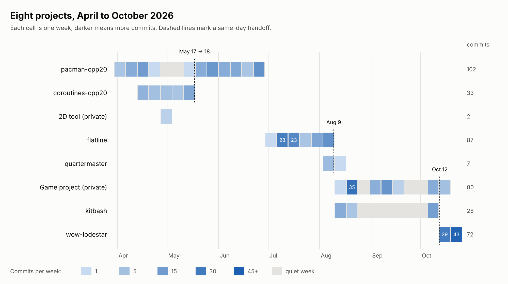

In April, I decided to find out whether AI could be more than a casual tool for me. I subscribed to Claude Pro and started projects... many projects. I began catching up with C++20 through a small game, built a [hands-on coroutines course](https://github.com/lcellentani/coroutines-cpp20) with Claude as my tutor, and planned games I had always wanted to make. Then the WoW Forever beta arrived. I asked Claude, "How hard is it to write a WoW addon?" Two weeks later I had a working one. I had never felt so empowered to build anything.

Then came the reality check. Looking back, I saw a lot of projects I had started and abandoned.

A line from a conversation with Claude struck me: with AI, starting costs almost nothing, and that is the trap in "everything feels possible". Abandoning costs nothing either, so nothing forces a decision. It is easy to beat ourselves up at moments like this, so I decided to test my assumptions against data: about 400 commits across eight projects between April and October 2026, built with AI assistance and a spec-driven workflow I also built. The findings surprised me.

**Finding 1: most projects weren't abandoned, they were closed.** My C++20 course ends with a commit literally called "Course Completed!". [Flatline](https://github.com/lcellentani/flatline) ends with "plan complete" and "spec Implemented". What faded was my appetite for the next spec, not my drive to keep working.

**Finding 2: the relay.** A new project often started the day the previous one ended. Flatline's last commit and [Quartermaster](https://github.com/lcellentani/quartermaster)'s first are on the same day, August 9. Sometimes a new project grew out of friction in the old ones: I was copying skills from project to project, so [Kitbash](https://github.com/lcellentani/kitbash) became a Claude Code plugin that packages them. Sometimes excitement took over: [Lodestar](https://github.com/lcellentani/wow-lodestar), my WoW addon, took all the air (and time) away from a game project. That game's last commit and Lodestar's first are both on October 12. And sometimes a project forced me to pause another: my [Pac-Man game](https://github.com/lcellentani/pacman-cpp20) stopped while I built the coroutines course, because I realized I hadn't properly grasped how coroutines could replace the classic state machine. The course's last commit is on May 17, and the Pac-Man work resumes on May 18.

**Finding 3: bursts.** Flatline had 52 commits in its first two weeks, then a much calmer pace. This matches my spec-driven discipline: I start every piece of work by writing a SPEC and a PLAN, small or large. The PLAN creates a clear target, and AI keeps me focused on following it from beginning to end. Lodestar looks different. I am its user, and two thirds of its commits (48 of 72) come between 10 pm and 2 am, in my free time. In its first two weeks, we reached almost every milestone planned for the beta. It is still young, though, so the real test is ahead.

*Weekly commits per project, April to October 2026.*

## What I learned

**1. Parking a project on purpose is not the same as leaving it unfinished.** The journey can be worth more than the goal you started with, but only if you keep track of what you learned. So I now write a short note for every project I park: what I built, what I learned, and what would make me resume.

**2. One active project and one maintenance project.** Starting is nearly free, so discipline is what gives each small effort its value.

**3. Ask the question at "Implemented".** When I reach that step, I will ask: "Next SPEC, or park?" If I park, I write down why.

If you sometimes feel, like me, that you don't progress or that you leave things behind, look at your own GitHub history with a short command like this one:

`git log --format=%ad --date=short | sort | uniq -c`

Then reflect on what you see, without judgment. It may surprise you.
